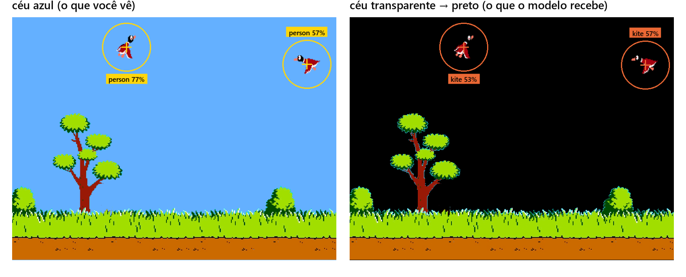
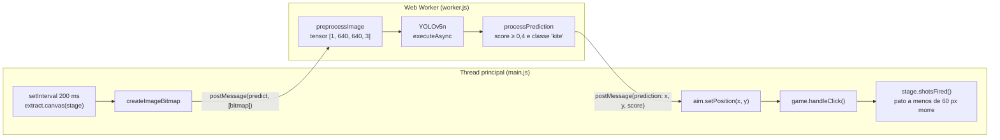
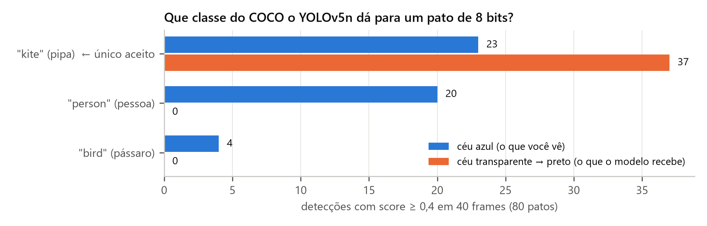
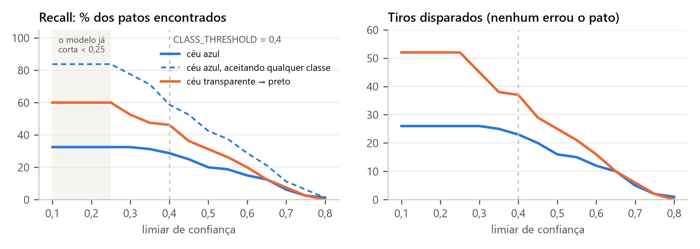

# IA Duck Hunt

Uma IA que joga **Duck Hunt** sozinha, direto no navegador. Um detector de objetos **YOLOv5n** pré-treinado roda com **TensorFlow.js** dentro de um **Web Worker**, olha a tela do jogo a cada 200 ms, encontra os patos e atira.

Nenhum modelo foi treinado aqui. O detector nunca viu um pato de 8 bits: ele foi treinado com fotos reais (dataset COCO, 80 classes) e o COCO não tem a classe "pato". O trabalho de engenharia está em volta do modelo: capturar a imagem certa, prepará-la, descobrir que o modelo enxerga o pato como **"pipa" (`kite`)**, filtrar essa classe e transformar a caixa detectada num clique.

> Projeto de estudo da pós-graduação em **Engenharia Aplicada a IA (UNIPDS)**, exemplo 02 "Vencendo qualquer jogo", parte 1. O jogo base é o [DuckHunt-JS](https://github.com/MattSurabian/DuckHunt-JS), de Matt Surabian.



## Sumário

- [Como funciona](#como-funciona)
- [O pipeline passo a passo](#o-pipeline-passo-a-passo)
- [Resultados medidos](#resultados-medidos)
- [Como rodar](#como-rodar)
- [Estrutura do projeto](#estrutura-do-projeto)
- [Tecnologias](#tecnologias)
- [Limitações e próximos passos](#limitações-e-próximos-passos)
- [Material de estudo](#material-de-estudo)
- [Créditos e licenças](#créditos-e-licenças)

## Como funciona

A IA repete o ciclo clássico de um agente: **perceber → decidir → agir**.



| Abordagem | Como funciona | Usada aqui? |
|---|---|---|
| Ler o estado interno | Lê a posição dos patos direto das variáveis do jogo | Não: não generaliza para outros jogos |
| **Visão computacional** | Um detector olha o frame e uma regra fixa decide o clique | **Sim** |
| Aprendizado por reforço | O agente aprende uma política jogando milhares de partidas | Não (outra etapa do curso) |

A tarefa é **detecção de objetos**, não classificação: para atirar é preciso saber **onde** está o pato. O modelo devolve, para cada objeto, uma caixa, uma classe e uma confiança.

## O pipeline passo a passo

### 1. Captura da tela (`machine-learning/main.js`)

```js
const worker = new Worker(new URL('./worker.js', import.meta.url), { type: 'module' });

setInterval(async () => {
    const canvas = game.app.renderer.extract.canvas(game.stage);
    const bitmap = await createImageBitmap(canvas);
    worker.postMessage({ type: 'predict', image: bitmap }, [bitmap]); // transfere, não copia
}, 200);
```

- O **Web Worker** roda a inferência em outra thread, então o jogo continua a 60 fps.
- O `ImageBitmap` é um **objeto transferível**: o segundo argumento de `postMessage` move a imagem para o worker sem copiar cerca de 1,9 MB por frame.
- `extract.canvas(game.stage)` renderiza só o container do jogo. A cor do céu é do *renderer*, então o céu chega **transparente**, e vira **preto** quando o alfa é descartado.

### 2. Pré-processamento (`machine-learning/worker.js`)

```js
function preprocessImage(input) {
    return tf.tidy(() => {
        const image = tf.browser.fromPixels(input)          // [H, W, 3], 0..255
        return tf.image
            .resizeBilinear(image, [640, 640])              // tamanho fixo do modelo
            .div(255)                                       // 0..1, como no treino
            .expandDims(0)                                  // [1, 640, 640, 3]: lote
    })
}
```

`tf.tidy` libera os tensores intermediários. No backend WebGL eles ficam na memória da GPU, fora do alcance do coletor de lixo do JavaScript.

### 3. Detecção com YOLOv5n

| Item | Valor |
|---|---|
| Formato | `graph-model` (TF.js Converter v4.5), só inferência |
| Parâmetros | 1.884.494, cerca de 7,5 MB em 2 shards `.bin` |
| Entrada | `[1, 640, 640, 3]`, float 0..1 |
| Saídas | `boxes [1, 100, 4]`, `scores [1, 100]`, `classes [1, 100]`, `valid_detections [1]` |
| Pós-processamento | NMS embutido no grafo (por isso `executeAsync`) |

No carregamento, o worker roda uma imagem falsa (**warmup**) para compilar os shaders do WebGL antes do primeiro frame real.

### 4. Filtro e mira

```js
function * processPrediction({ boxes, scores, classes }, width, height) {
    for (let index = 0; index < scores.length; index++) {
        if (scores[index] < CLASS_THRESHOLD) continue      // confiança mínima: 0,4
        if (_labels[classes[index]] != 'kite') continue    // só a classe "pipa"
        let [x1, y1, x2, y2] = boxes.slice(index * 4, (index + 1) * 4)
        // coordenadas 0..1 → pixels, depois o centro da caixa
        yield { x: ..., y: ..., score: ... }
    }
}
```

Cada `yield` vira uma mensagem `prediction`, e cada mensagem vira um tiro.

### 5. O tiro

Na thread principal, a mira vai para o ponto previsto e a IA chama o **mesmo** `handleClick` que o mouse do jogador usa, com as mesmas regras de balas e pontuação. `stage.shotsFired` mata todo pato vivo a menos de **60 px** do tiro.

## Resultados medidos

Para medir em vez de supor, o mesmo modelo e o mesmo pré-processamento do `worker.js` foram rodados (TensorFlow.js 4.22, Node.js) em **40 cenas montadas com os sprites originais do jogo**, com 2 patos de cor, pose e posição aleatórias em cada uma (80 patos). Cada cena foi testada com o céu azul que o jogador vê e com o céu transparente que o modelo realmente recebe.

| Métrica (classe `kite`, score ≥ 0,4) | Céu azul | Céu transparente → preto |
|---|---|---|
| **Precisão** (tiros que acertaram um pato) | 100% | 100% |
| **Recall** (patos encontrados por frame) | 28,8% (23/80) | 46,2% (37/80) |
| Recall aceitando qualquer classe | 58,8% | 46,2% |
| Recall do pato vermelho × preto | 50% × 11,4% | 69,4% × 27,3% |



O que os números mostram:

- **O mesmo pato muda de classe quando o fundo muda.** No céu azul, quase metade das detecções vira `person` e é descartada pelo filtro. No fundo preto, tudo vira `kite`. É *domain shift* na prática.
- **Nenhum tiro saiu no vazio.** O gargalo é o recall, não a precisão.
- **Baixar o limiar de 0,4 para 0,25** sobe o recall de 46% para 60% sem criar tiros errados neste teste. Abaixo de 0,25 nada muda, porque o NMS do modelo já cortou essas caixas.
- **A IA ganha mesmo assim** porque captura 5 frames por segundo e cada pato fica vários segundos na tela.



> Frames do jogo ao vivo variam, então os números de uma partida real não são exatamente estes. As conclusões se mantêm.

## Como rodar

Pré-requisitos: [Node.js](https://nodejs.org/) 20 ou superior e um navegador com WebGL.

```bash
npm install
```

```bash
npm start
```

O `webpack-dev-server` abre `http://localhost:8080`. A IA começa a jogar sozinha assim que o modelo carrega. Abra o console para ver cada `AI predicted at: (x, y)` e acompanhe o HUD da IA no canto superior direito.

Outros comandos:

| Comando | O que faz |
|---|---|
| `npm run build` | Gera o bundle em `dist/` |
| `npm run lint` | Roda o ESLint em `src/` |
| `npm run audio` / `npm run images` | Reconstrói os sprites de áudio e imagem (precisa de ffmpeg / TexturePacker) |

> Abrir `index.html` direto pelo `file://` não funciona: o `fetch` do modelo é bloqueado por CORS.

### Parâmetros para experimentar

| Onde | Constante | Padrão | Efeito |
|---|---|---|---|
| `machine-learning/worker.js` | `CLASS_THRESHOLD` | `0.4` | Mais alto: menos tiros errados, menos patos achados |
| `machine-learning/worker.js` | `label != 'kite'` | `'kite'` | Classe do COCO aceita como "pato" |
| `machine-learning/main.js` | intervalo do `setInterval` | `200` ms | Frequência de captura |
| `src/data/levels.json` | `radius` | `60` | Raio do tiro em pixels |

## Estrutura do projeto

```
.
├── main.js                       # entrada: cria o Game e liga a IA
├── machine-learning/
│   ├── main.js                   # captura, worker, mira e tiro
│   ├── worker.js                 # TF.js + YOLOv5n: pré-processo, inferência, filtro
│   ├── layout.js                 # HUD da IA (score e última previsão)
│   └── yolov5n_web_model/        # model.json, 2 shards .bin, labels.json (80 classes COCO)
├── src/
│   ├── modules/                  # jogo original: Game, Stage, Duck, Dog, Aim, Hud...
│   ├── libs/                     # utilitários e criador de níveis
│   └── data/levels.json          # 6 níveis: ondas, patos, balas, velocidade, raio
├── dist/                         # build pronto (index.html, sprites, áudio, bundle)
├── docs/
│   ├── guia-estudo-ia-duckhunt-yolo.pdf     # guia de estudo completo (18 páginas)
│   ├── lousa-ia-duckhunt-a4-horizontal.pdf  # mapa de estudo em 1 página A4
│   ├── img/                                 # gráficos do experimento
│   └── README-original.md                   # README do DuckHunt-JS original
└── webpack.config.js             # copia o modelo para dist/ (CopyWebpackPlugin)
```

## Tecnologias

| Peça | Papel |
|---|---|
| [TensorFlow.js](https://www.tensorflow.org/js) | Executa o modelo no navegador (WebGL) |
| [YOLOv5n](https://github.com/ultralytics/yolov5) | Detector de objetos de um estágio, versão nano |
| Web Workers | Inferência fora da thread do jogo |
| [PixiJS](https://pixijs.com/) | Motor 2D do jogo e `renderer.extract` para capturar a cena |
| webpack 5 | Bundle do jogo e do worker, cópia do modelo para `dist/` |
| GSAP, Howler.js | Animações e áudio do jogo original |

## Limitações e próximos passos

| Ponto | Situação atual | Melhoria possível |
|---|---|---|
| Fila de frames | `setInterval` não espera o worker; se a inferência passar de 200 ms, os frames se acumulam | *Backpressure*: só capturar quando o worker responder |
| Mira atrasada | Mira onde o pato estava no momento da captura | Estimar a velocidade entre frames e mirar à frente |
| Balas gastas | Cada detecção vira um tiro, inclusive duplicadas | Um tiro por frame, no pato de maior score |
| Regra de classe frágil | Patos vistos como `person` ou `bird` são descartados | Aceitar mais classes ou fazer *fine-tuning* com frames rotulados do jogo |
| Versão do TF.js | `@tensorflow/tfjs@latest` via CDN | Fixar a versão (ex.: `4.22.0`) |
| `valid_detections` | Ignorada; o laço percorre as 100 linhas | Ler a 4ª saída e parar nela |

## Material de estudo

- [Guia de estudo completo (PDF, 18 páginas)](docs/guia-estudo-ia-duckhunt-yolo.pdf): pipeline, tensores, YOLO, NMS, experimento, avaliação crítica, exercícios, glossário, perguntas com gabarito e resumo.
- [Lousa A4 horizontal (PDF, 1 página)](docs/lousa-ia-duckhunt-a4-horizontal.pdf): mapa de estudo em 6 blocos para imprimir.

## Créditos e licenças

- Jogo base: [DuckHunt-JS](https://github.com/MattSurabian/DuckHunt-JS), de Matt Surabian, sob licença MIT (ver [LICENSE](LICENSE)). O README original está em [docs/README-original.md](docs/README-original.md).
- Modelo: [YOLOv5](https://github.com/ultralytics/yolov5), da Ultralytics, distribuído sob AGPL-3.0. Os pesos em `machine-learning/yolov5n_web_model/` seguem a licença da Ultralytics.
- Integração da IA, experimento e material de estudo: projeto da pós-graduação em Engenharia Aplicada a IA (UNIPDS).
